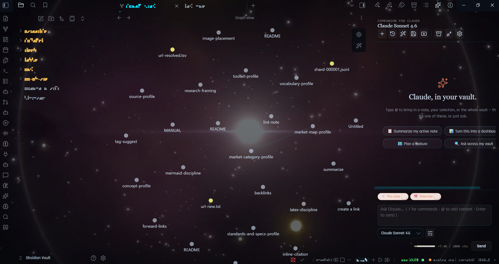

# No Mans Sky - Atlas

A deep-space, No Man's Sky-inspired theme for [Obsidian](https://obsidian.md). Your notes float on a living galaxy, headings are written in the Korvax alphabet and translate to English when you hover them, and the whole window boots like an Atlas terminal.

> Cyan & gold HUD · galaxy background · alien glyph headings · dark + light · deep Style Settings.

<!-- Add a real capture named screenshot.png at the repo root, then this will render: -->

## Features

- **Galaxy background** behind the whole workspace — fully transparent panes, no boxed "sharp edges," with a readability dimming layer. Embedded in the CSS (no external files).
- **Korvax glyph headings** — note titles, reading-view headings, callout titles and tags render in the real NMS alphabet and **decode to English on hover**. Body text stays English and editable.
- **Atlas boot splash** — a scanner ring + "Establishing link" plays when the vault opens (reduced-motion safe, never blocks clicks).
- **Cyan & gold HUD** — Orbitron / Rajdhani type, accent glow, HUD grid, corner brackets on the active note, gold status-bar markers, scan-in title reveal, console-styled toasts/tables/code.
- **Galaxy backdrops** — recolor the nebula: Atlas Purple, Toxic Green, Scorched Red, Frozen Cyan, Irradiated Gold.
- **NMS callouts** — `> [!atlas]`, `> [!sentinel]`, `> [!korvax]`, `> [!vykeen]`, `> [!gek]`, `> [!traveller]`, `> [!anomaly]`, `> [!scan]`.
- **Canvas styling** — Obsidian canvas cards, groups, connectors and controls get the HUD look: cyan (or per-colour) borders with corner brackets, dashed groups, console-style labels. Turn it off with **Disable canvas styling** in Style Settings.
- **Focus / writing mode** — calms the galaxy and reverts glyphs to English for distraction-free writing.
- **Live cockpit (optional)** — a Dataview home note with a rotating star chart under a cockpit arch, expedition and ship tiles, and a ship that flies in when your vault levels up. See `nms-live-cockpit/`.
- **Dark + light** — dark is the deep-space console; light is "Daylight Scanner."

## Install

**From the community store (once published):** Settings → Appearance → Themes → Manage → search "No Mans Sky - Atlas".

**Manual:**
1. Copy `theme.css` and `manifest.json` into `<your vault>/.obsidian/themes/No Mans Sky - Atlas/`.
2. Settings → Appearance → Themes → select it. Set the colour scheme to **Dark** for the full effect.
3. (Recommended) install the **Style Settings** community plugin to unlock the control panel below.

## Full alien interface (optional)

Out of the box only the headings use the NMS alphabet. To make the whole window alien (files, folders, tabs, menus, settings, the new-tab page), set the font yourself:

1. Settings → Appearance → **Interface font**.
2. If NMS Alphabet is not in the font list yet, install it first: download [`nms-alphabet.ttf`](nms-glyph-translate/assets/nms-alphabet.ttf) from this repo, open it and click **Install** (Windows/Mac), then restart Obsidian. Add **NMS Alphabet** to the list and make sure it is **at the top**. Obsidian uses the first font in the list that it can find, so any font above NMS Alphabet (for example Arial Rounded MT) wins and nothing turns alien. Drag it up with the ≡ handle, or remove the fonts above it with the X.
3. (Optional) do the same for **Text font** to turn note text alien too. Not recommended for writing.

Hover any alien item, menu, tooltip or paragraph and it switches to English, and the line you are editing is always English. To stay fully alien, turn on **Disable hover-to-translate** in Style Settings. To go back to normal, remove NMS Alphabet from the font list.

## Style Settings panel

Open Settings → Style Settings → **No Mans Sky - Atlas**:

- **Accent color** — Atlas Cyan / Exosuit Gold / Atlas Path Red / Sentinel Green / Anomaly Violet
- **Glow & atmosphere** — accent glow + strength, HUD grid (+ animate), CRT scanlines, vignette
- **Galaxy** — disable galaxy background, editor dimming
- **Immersion** — galaxy backdrop, full-immersion glyphs (nav/tabs too), focus mode, disable boot splash, disable corner brackets
- **Layout & explorer** — rainbow biome folders, translucent panels, hide borders, readable headings
- **Typography** — body / heading / interface fonts and body font size

Everything works at sensible defaults even without Style Settings; the plugin just exposes the controls.

## Companion pieces (optional, in this repo)

- `nms-discovery-toast/` — a tiny plugin that fires "◆ ENTRY REGISTERED / DATA SYNCED" toasts on note create/save (CSS can't hook those events). Copy into `.obsidian/plugins/` and enable.
- `nms-live-cockpit/` — the live cockpit home note: a CSS snippet, the note itself and an example vault. Needs Dataview and Style Settings. See its README.
- `nms-glyph-translate/` — the standalone glyph-on-hover component (CSS + JS + offline demo) for use in web projects.

## Notes & credits

- UI fonts (Orbitron, Rajdhani) load from Google Fonts on first run. The NMS alphabet font and the galaxy image are embedded in `theme.css`.
- NMS Alphabet font used with permission from seontonppa. A copy of the font file is included in `nms-glyph-translate/assets/` for installing it as your interface font.
- Unofficial fan project, inspired by No Man's Sky (Hello Games); not affiliated or endorsed. See `LICENSE` (MIT) for the license terms.
- The "NMS Alphabet" font and the No Man's Sky aesthetic are inspired by No Man's Sky (Hello Games). Replace bundled assets with your own before redistribution if you wish to avoid any third-party rights concerns.
- To publish to the Obsidian community themes list, see `PUBLISHING.md`.
