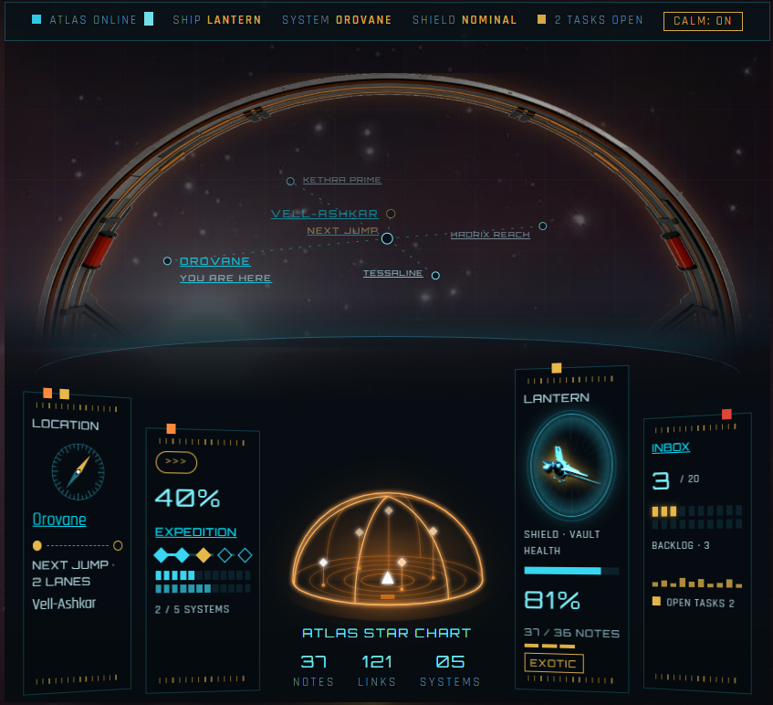
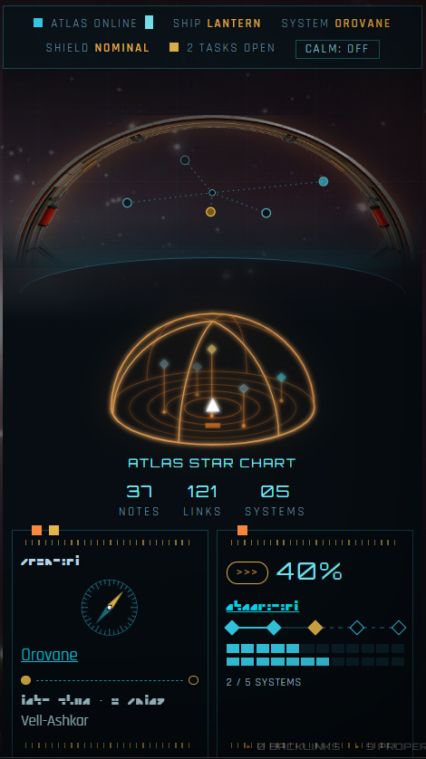

# Atlas Live Cockpit (optional)

A live No Man's Sky cockpit for your vault's home note. A rotating star chart under a cockpit arch, with tiles for your location, expedition route, ship, inbox and a rotating dome. It reads your vault live through Dataview, so the numbers and names are always your own.

On a narrow pane or a phone the cockpit stacks into two columns:

## What it shows

- **Star chart:** your notes in the `Systems` folder, with lanes drawn from their links. Drag to spin or tilt it. Click or tap a star to open its system note.
- **Location and expedition tiles:** your current system, the next jump and how far along your route you are.
- **Ship tile:** your ship changes class (Shuttle, Fighter, Exotic) as your vault grows. When it levels up, the new ship flies in. Click the ship to replay it.
- **Inbox, backlog and open tasks:** counts from your `Inbox` and `Backlog` folders and your unchecked tasks.
- **Calm button:** the status strip has a Calm button that stops all motion with one click and remembers your choice.
- **Scan sweep:** a scan line passes down the arch and flips the alien-font words to English and back. Hover any alien word to read it in English.

## Install

1. Install the **Dataview** community plugin and enable **JavaScript queries** in its settings. Install **Style Settings** too.
2. Copy `nms-cockpit.css` into `<your vault>/.obsidian/snippets/` and switch it on under Settings → Appearance → CSS snippets. Use the **No Mans Sky - Atlas** theme.
3. Copy `00 Home.md` from `example-vault/` into your vault and open it in **Reading view**.
4. Change the frontmatter at the top of that note to your own names (see below).

To try it first, open the `example-vault` folder as a vault, then do steps 1 and 2 above (the example vault has no plugin or snippet settings of its own).

## Frontmatter

| Field | Meaning |
|---|---|
| `ship` | Name of a note in your vault, shown on the ship tile |
| `system` | Your current system (a note in `Systems`) |
| `expedition` | A note whose tasks link to systems in order, which makes the route |
| `goal` | How many notes you aim for. 50% gives the Fighter, 100% the Exotic |
| `inbox-capacity`, `backlog-capacity` | The size of the bars |

## Folders it reads

`Systems`, `Planets` (with a `system:` field), `Inbox`, `Backlog` and `Expeditions`. Missing folders show zero.

## Style Settings

Open Settings → Style Settings → **Atlas Cockpit** to turn on **Calm mode** (stops all motion and keeps labels in English) or switch off individual effects: moving bars, scan sweep, lane flow, boot line, shield pulse, dome radar, tile motion and the rotating star chart. Calm mode also switches on by itself if your system asks for reduced motion.

## Notes

- Works best in a wide pane. On narrow panes the tiles stack.
- The note's Properties are folded to save space. Hover them to open.
- All systems, planets and creatures in `example-vault` are invented.
